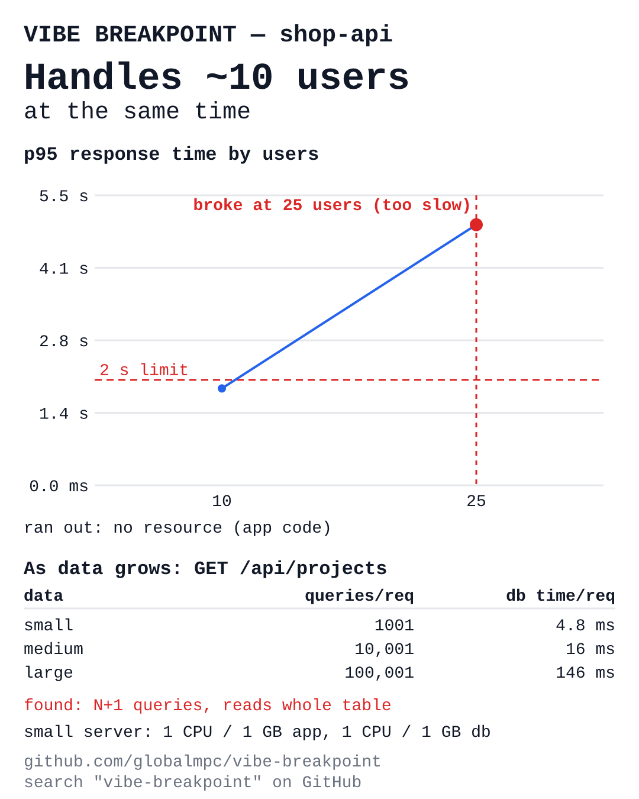

# vibe-breakpoint



*Example from the bundled `express-pg` test app on a simulated small server (short run: 10 and 25 users, 20 s each).*

**Find out how many users your vibe-coded app can handle at the same time, and which database queries get slower as your data grows.** A Claude Code skill. One command: `/vibe-breakpoint`.

## Install
```
npx skills add globalmpc/vibe-breakpoint --skill vibe-breakpoint -g -a claude-code
```

This copies the skill (with its bundled script, templates and font) to `~/.claude/skills/vibe-breakpoint/`. Restart Claude Code, open your project and run `/vibe-breakpoint`. Update by running the command again. Remove with `npx skills remove vibe-breakpoint -g`.

No Node tooling? `git clone https://github.com/globalmpc/vibe-breakpoint && cp -r vibe-breakpoint/skills/vibe-breakpoint ~/.claude/skills/` does the same.

## What it measures

- **Breaking point:** it ramps up simulated users (10, 25, 50, 100, 200, 400) and tells you how many your app handles at the same time before it gets too slow or starts failing.
- **Data growth:** it fills a test database with small, medium and large amounts of fake data and shows which endpoints get slower. It flags **N+1 queries**, **missing indexes** (confirmed with `EXPLAIN`) and **endpoints that read a whole table**.
- **Output:** `chart.png` (shareable), `chart.svg` and `report.md` with plain-language causes and a ready-to-paste fix prompt for each finding.

Every number comes from a measurement. Claude writes the test inputs and explains the results; scripts do the measuring.

## What it never touches

- **Your project is never modified.** The test runs on a temporary copy. The only thing written into your project is the folder `.vibe-breakpoint/`.
- **Your databases are never used.** The test database is a fresh Postgres container in memory, created and deleted per run. No database URL from your config is ever used.
- **Env vars: names only.** Real `.env*` files are never opened by Claude. The test gets generated fake values for every name.
- **No outside calls.** The app runs on a Docker network without internet. OpenAI, Anthropic, Stripe and Resend calls go to a local mock server.
- **Local only.** Load goes only to the app inside the test environment, never to a public or production URL.
- **It asks first.** Pulling images and building containers needs your OK, once per run.

## Requirements

- Docker (Engine 25+ with Compose 2.20.2+). Without Docker you only get a static report from reading the code, clearly labelled "no load test ran".
- Node 20+ (the skill ships a single script; nothing to `npm install`).
- A Node backend (Next.js or Express-style) that talks to Postgres directly (Prisma, Drizzle, Knex or `pg`). Supabase/Firebase client-API apps, non-Node backends and staging URLs are not supported yet.
- Time: about 10-15 minutes with the default ramp.

## How the breaking point is defined

A stage is **broken** when the p95 response time is above **2 seconds**, or more than **1 %** of requests fail. The result is "handles about N users", where N is the last stage before the first broken one. If no stage breaks, the report says "no breaking point up to 400". The report also says what ran out: app CPU, database CPU, memory, or "app code" (it got slow without a saturated resource).

## Server profiles

The test runs on a fixed, printed profile so numbers are comparable.

| Profile | App | Database | Roughly |
|---|---|---|---|
| `small` (default) | 1 CPU / 1 GB | 1 CPU / 1 GB | a 2 vCPU / 2 GB VPS |
| `tiny` | 0.5 CPU / 512 MB | 0.5 CPU / 512 MB | the smallest hosted tier |

## Limits

- It is a local estimate on a simulated server, not your hosting. Network, cold starts and connection limits are not included.
- Outside services are an instant mock, so their latency and rate limits are not measured. SDK calls that cannot be pointed at the mock fail on the offline network and are listed in the report.
- Test data is generated; real data and real traffic differ.
- Production builds only. Postgres only. No streaming (SSE) responses from the mock.

## Cleanup

Everything the tool creates carries a run label and is removed when the run ends, fails or is interrupted. If a run was killed hard, remove leftovers with:

```
node ~/.claude/skills/vibe-breakpoint/scripts/vibe-breakpoint.mjs cleanup
```

(`cleanup --all` also removes runs that still look alive.) The folder `.vibe-breakpoint/` in your project holds the results and can be deleted any time.

## License

MIT. Bundled fonts and the PNG renderer keep their own licences, see `skills/vibe-breakpoint/assets/`.

## Related

- **vibe-preflight**: pre-flight check of a vibe-coded app before it goes live (secrets, access control, dependencies, deploy readiness).
- **vibe-bill**: estimate what the app costs to run at 100 / 1k / 10k / 100k users.

## Development

`npm install`, `npm run build`, `npm test`, `npm run test:e2e` (needs Docker). Plan, contracts and decisions are in `docs/`.
